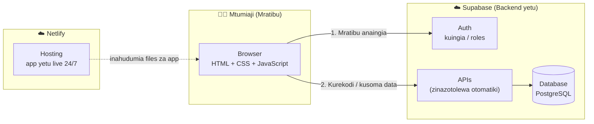
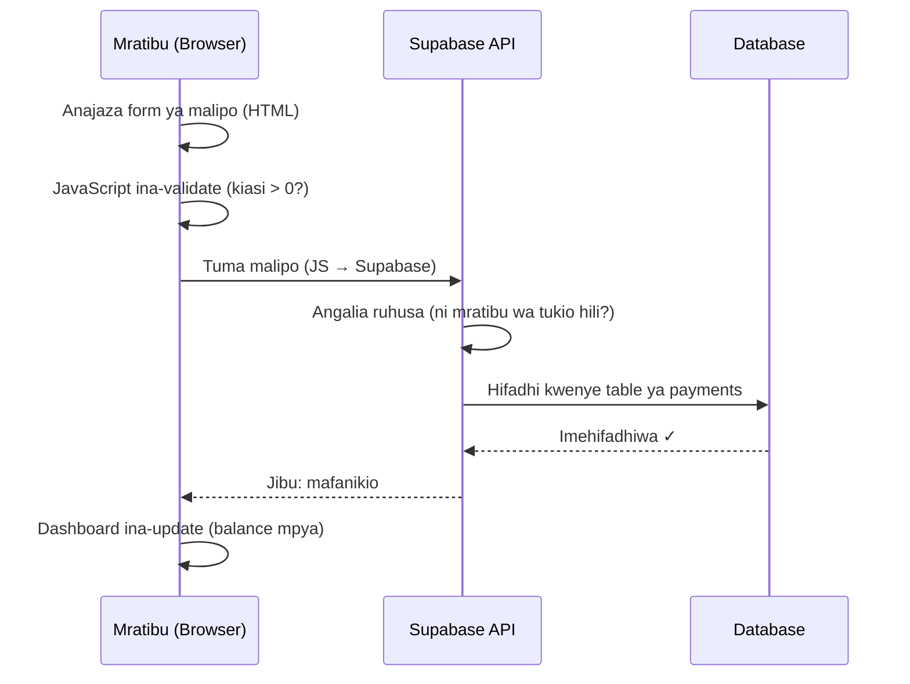

# System Architecture — Michango Manager

**Session 3 · Safari ya Software Development**

## Picha Kubwa

Michango Manager inatumia architecture ya **Backend as a Service (BaaS)**: badala ya kujenga na kusimamia server yetu wenyewe, tunatumia **Supabase** — inayotupa database, authentication, na APIs tayari. Frontend yetu (HTML/CSS/JS) inaongea na Supabase moja kwa moja.

## Safari ya Malipo — Mfano Mmoja Unaofundisha Yote

Mratibu anarekodi malipo ya TZS 50,000. Yanapita wapi?

## Kipande Gani Kinaishi Wapi?

| Kipande | Kinaishi | Mfano wa requirement |
|---|---|---|
| Forms na screens | Frontend (`app/`) | FR-B1 (form ya tukio), FR-E1 (form ya malipo) |
| Hesabu za kuonyesha | Frontend (JavaScript) | FR-E3 (balance), FR-F1 (asilimia) |
| Kuingia na roles | Supabase Auth | FR-A1, FR-A2 |
| Kuhifadhi na kusoma data | Supabase Database | Kila kitu! |
| Usalama wa data | Supabase (Row Level Security) | NFR-3 |
| App kuwa live | Netlify | NFR-6 |

## Kwa Nini Architecture Hii?

- **Hakuna server ya kusimamia** — Supabase inafanya kazi nzito; sisi tunajenga kile mtumiaji anachokiona na kukitumia
- **Ni ya kisasa na halisi** — makampuni mengi ya kweli yanaanza hivi hivi
- **Inatufikisha deployment** — kila kipande kina free tier; app yetu itakuwa live bila gharama

## Nje ya Mchoro (kwa makusudi)

Hakuna server yetu wenyewe, hakuna Docker, hakuna mobile app — angalia sehemu ya "Nje ya Wigo" kwenye [requirements](../02-requirements/requirements.md).
