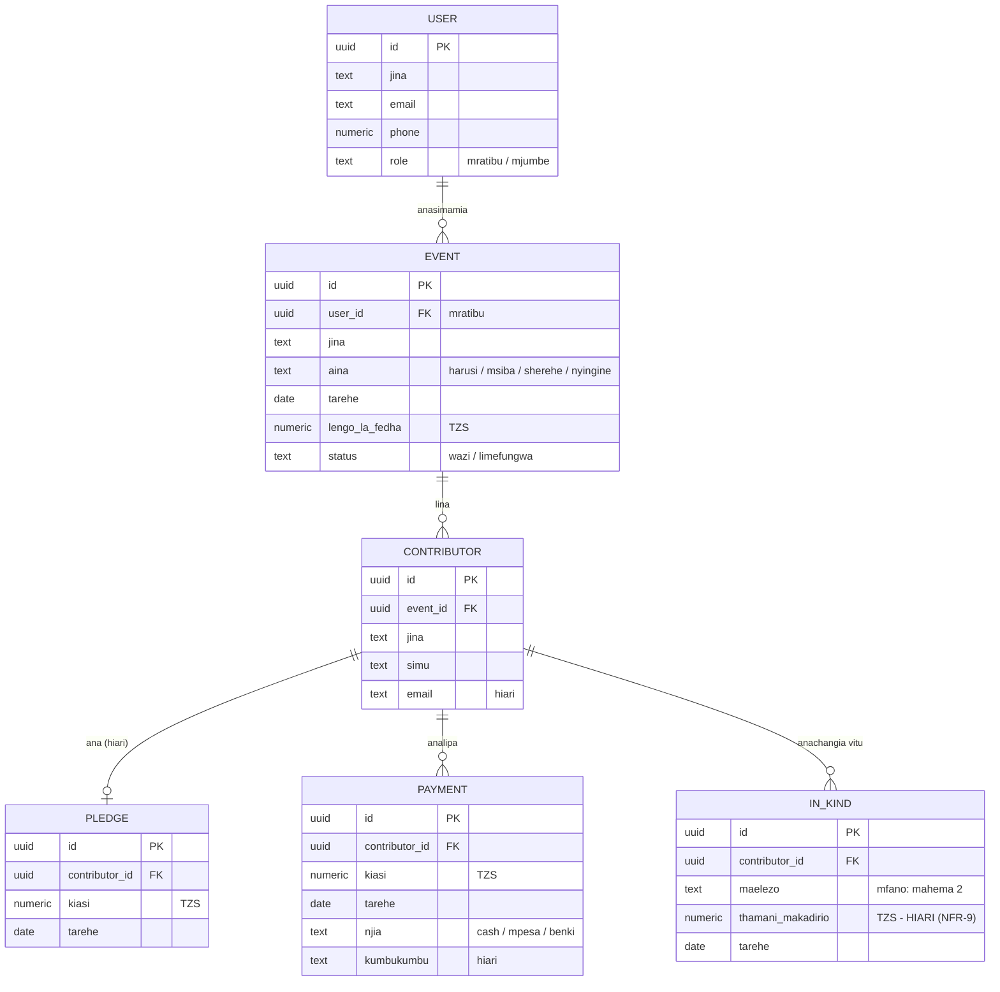

# ERD — Data Model ya Michango Manager

**Session 3 · Safari ya Software Development**

Entities hizi zinatoka kwenye [requirements](../02-requirements/requirements.md) — kila FR inataja "vitu"; hivi ndivyo vitu hivyo na uhusiano wao. Session ya database, kila entity hapa itakuwa **table** kwenye Supabase.

## Kusoma Mchoro

- `||--o{` inamaanisha **one-to-many**: tukio MOJA lina wachangiaji WENGI; mchangiaji MMOJA ana malipo MENGI (FR-E2 — malipo kidogo kidogo!)
- `||--o|` kwenye PLEDGE: mchangiaji ana ahadi **moja au hana kabisa** — kwa sababu FR-D3 inaruhusu kulipa bila ahadi
- **PK** = Primary Key (kitambulisho cha kipekee cha kila row) · **FK** = Foreign Key (kiungo kwenda entity nyingine)

## Maswali Yaliyotupa Uhusiano Huu

| Swali                                    | Jibu                                                            | Matokeo kwenye model      |
| ---------------------------------------- | --------------------------------------------------------------- | ------------------------- |
| Tukio moja lina wachangiaji wangapi?     | Wengi                                                           | EVENT →many CONTRIBUTOR   |
| Mchangiaji analipa mara ngapi?           | Nyingi (kidogo kidogo)                                          | CONTRIBUTOR →many PAYMENT |
| Kila mchangiaji lazima awe na ahadi?     | Hapana (FR-D3)                                                  | PLEDGE ni hiari           |
| Bibi wa gunia la mchele anaonekana wapi? | IN_KIND                                                         | Table yake kamili (FR-H1) |
| Balance inahifadhiwa wapi?               | **Haihifadhiwi** — inahesabiwa: ahadi − jumla ya malipo (FR-E3) | Hakuna column ya balance! |

> **Kanuni ya mwisho ni muhimu:** balance haihifadhiwi kwenye database — inahesabiwa kila inapohitajika. Ukihifadhi kitu kinachoweza kuhesabiwa, siku moja kitakosana na ukweli. Hii itakuwa function yetu ya kwanza muhimu: `calculateBalance()`.

## Bado Hatujaamua (Session ya Database)

- Je, CONTRIBUTOR anaweza kuwa kwenye matukio mengi kwa record moja, au kila tukio ana record yake? (Toleo la kwanza: kila tukio ana record yake — rahisi zaidi)
- Makundi ya wachangiaji (FR-C5 — Could) yataingiaje model?
